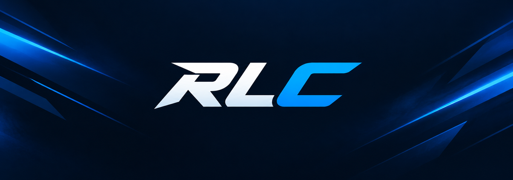
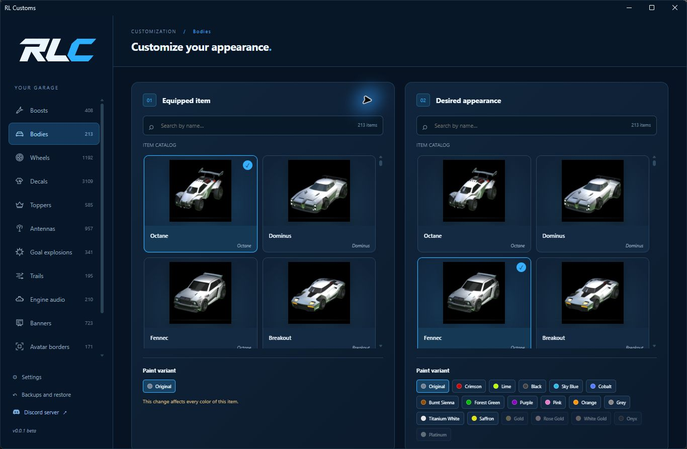

  

<h3 align="center">Your garage. Your style.</h3>

  Explore new looks for your Rocket League garage with RL Customs.

  
  &nbsp;
  

 

## Watch RL Customs in action

  

<a href="https://www.youtube.com/watch?v=3rmY66QJVVg">▶ Watch the video on YouTube</a>

## New in 0.0.6 Beta

- **Fixed issues** affecting wheels and car bodies.
- **Verification codes** via `/key` in Discord.
- **Custom car paint colors**, including an all-black setup.
- **Discord Rich Presence**.

> The 3D Car Builder is experimental, available in Settings and disabled by default. It does not yet support every item or effect.

## Your garage, reimagined

Browse cars, boosts, wheels, decals and more. Pick the item you have equipped, choose the appearance you want to see and preview your selection before applying it.

  

### Made for your style

- **Discover** items across your favorite categories with search and previews.
- **Personalize** your selection with available color variants.
- **Save presets** with names and share them using a unique code.
- **Import presets** and choose which items to replace.
- **Restore** your changes from the app whenever you want.
- **Choose your language:** English or Spanish.
- **Stay up to date** with notifications for new versions.

## Get started

1. Download **RLC.exe** from the [beta release](https://github.com/cortexstudiosinfo/RL-Customs/releases/tag/v0.0.6-beta) and open it on Windows.
2. Join the [RL Customs Discord](https://discord.gg/rlcustoms), complete verification and make sure you have the **User** role.
3. Run `/key` in **#key** and paste your verification code into RL Customs.
4. Choose your equipped item and the appearance you want. Select an available color, then check and prepare the change.
5. Close Rocket League before applying. Use **Backups and restore** to restore an item.

If your game is not detected or the catalogue appears empty, open **Settings** and select your Rocket League installation folder manually.

## Help shape RL Customs

Found a bug or have a suggestion? Let us know on our [Discord server](https://discord.gg/rlcustoms). Your feedback helps us keep improving RL Customs.

## Beta information

RL Customs is in beta. Availability and compatibility depend on the selected items and installed game version. Appearance changes are local and may need to be reapplied after a game update.

---

RL Customs is proprietary, closed-source software. All rights reserved.

Rocket League is a trademark of Psyonix LLC. RL Customs is an independent project and is not affiliated with or endorsed by Psyonix or Epic Games.

