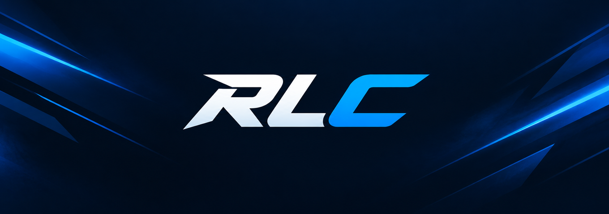
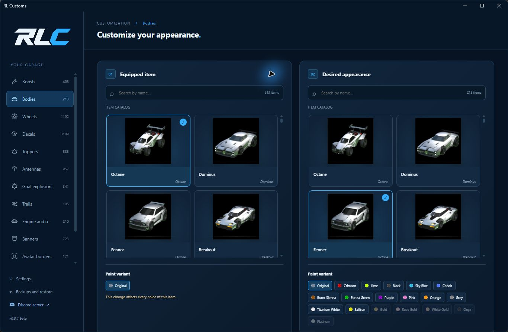

  

<h3 align="center">Your garage. Your style.</h3>

  Explore new looks for your Rocket League garage with RL Customs.

  
  &nbsp;
  

 

## Watch RL Customs in action

  

<a href="https://www.youtube.com/watch?v=3rmY66QJVVg">▶ Watch the video on YouTube</a>

## Your garage, reimagined

Browse cars, boosts, wheels, decals and more. Pick the item you have equipped, choose the appearance you want to see and preview your selection before applying it.

  

### Made for your style

- **Discover** items across your favorite categories with search and previews.
- **Personalize** your selection with available color variants.
- **Restore** your changes from the app whenever you want.
- **Choose your language:** English or Spanish.
- **Stay up to date** with notifications for new versions.

## Get started

1. Download **RLC.exe** from the [beta release](https://github.com/cortexstudiosinfo/RL-Customs/releases/tag/v0.0.1-beta) and open it on Windows.
2. Join the [RL Customs Discord](https://discord.gg/PY5sY6hzB4), complete verification and make sure you have the **User** role.
3. Sign in with Discord in the app.
4. Choose your equipped item and the appearance you want. Select an available color, then check and prepare the change.
5. Close Rocket League before applying. Use **Backups and restore** to restore an item.

## Beta information

RL Customs is in beta. Availability and compatibility depend on the selected items and installed game version. Appearance changes are local and may need to be reapplied after a game update.

---

RL Customs is proprietary, closed-source software. All rights reserved.

Rocket League is a trademark of Psyonix LLC. RL Customs is an independent project and is not affiliated with or endorsed by Psyonix or Epic Games.

