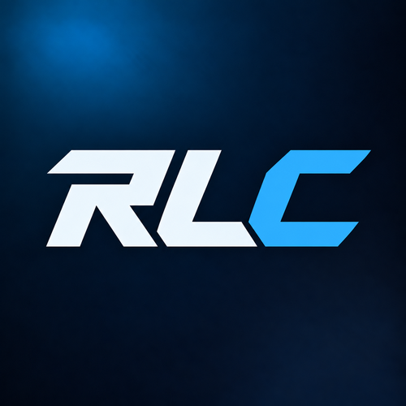

# RL Customs

Make your Rocket League garage your own. Browse cars and other items, choose an appearance and preview your selection in a clean desktop app.

[Download the beta](https://github.com/cortexstudiosinfo/RL-Customs/releases) · [Join our Discord](https://discord.gg/PY5sY6hzB4)

## Explore your garage

- Browse bodies, boosts, wheels, decals, goal explosions and more.
- Search for items, choose available colors and preview a change.
- Keep track of changes and restore items from the app.
- Use the interface in English or Spanish.
- See when a new version is available.

## Getting started

1. Download **RLC.exe** from [Releases](https://github.com/cortexstudiosinfo/RL-Customs/releases) and open it on Windows.
2. Join the [RL Customs Discord](https://discord.gg/PY5sY6hzB4), complete verification and make sure you have the **User** role.
3. Sign in with Discord in the app.
4. Choose the item you have equipped and the appearance you want to see. Select an available color, then check and prepare the change.
5. Close Rocket League before applying a change. Use **Backups and restore** when you want to restore an item.

## Beta

RL Customs is in beta. Availability and compatibility depend on the selected items and the installed game version. Appearance changes are local and may need to be reapplied after a game update.

RL Customs is proprietary, closed-source software. All rights reserved.

Rocket League is a trademark of Psyonix LLC. RL Customs is an independent project and is not affiliated with or endorsed by Psyonix or Epic Games.
